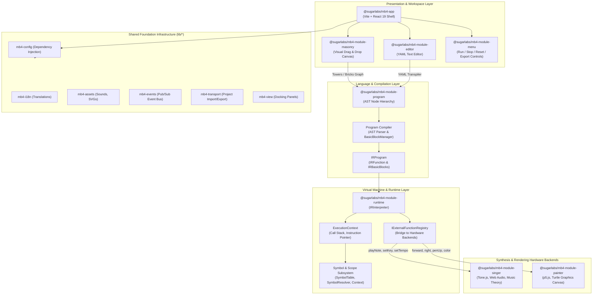
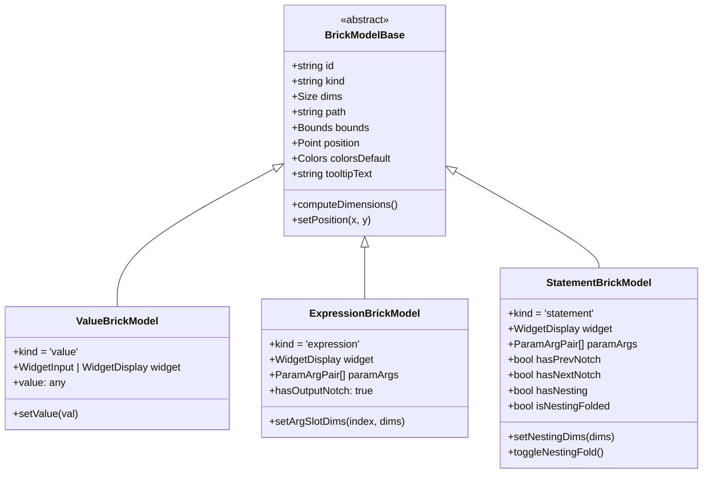
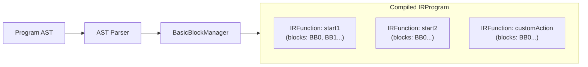
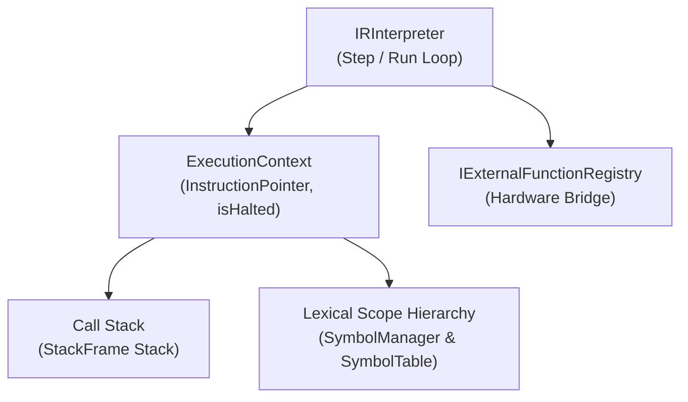
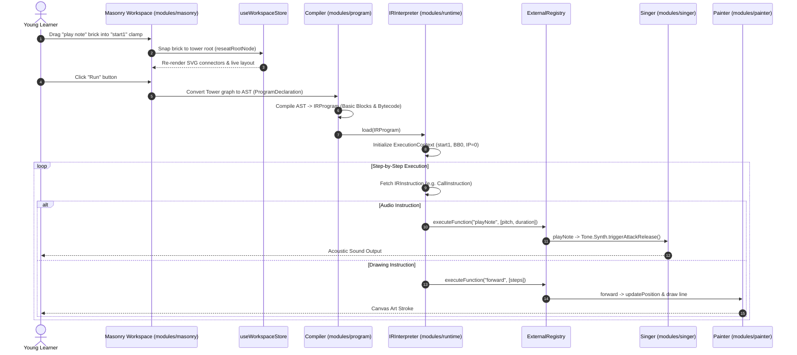

# Music Blocks (v4): Comprehensive Codebase & Architecture Guide

This document provides an exhaustive technical analysis of the **Music Blocks v4** codebase, its architectural patterns, sub-modules, data pipelines, compiler design, virtual machine, and visual drag-and-drop workspace.

---

## 1. Executive Summary & Purpose

**Music Blocks** is an interactive, visual programming platform developed for **Sugar Labs**—the non-profit organization behind the educational software suite originally created for the One Laptop per Child (OLPC) project.

Music Blocks sits at the intersection of **music theory**, **mathematical computation**, **visual art**, and **computer science**:
* **Learners (Ages 5–14+)** snap colorful visual code bricks together to compose polyphonic music, program dynamic rhythms, and generate geometric turtle art.
* **No Syntax Errors**: Like Scratch or Blockly, visual connectors (tabs and notches) prevent syntax errors while enforcing type constraints (e.g., arguments cannot attach to statement sequence slots).
* **Constructionist Learning**: Inspired by Seymour Papert's Logo turtle geometry and constructionist learning theories, learners explore algorithmic concepts (loops, functions, variables, conditionals, concurrency) while hearing their mathematical transformations in real-time.

### Why Version 4?
Music Blocks v1–v3 evolved over years as an open-source web application, accumulating tight coupling between brick rendering, music synthesis, and execution logic. **Version 4 (`musicblocks-v4`)** is a complete, modular, ground-up rebuild designed as a monorepo of reusable packages:
* **Separation of Concerns**: Visual brick manipulation (`masonry`), program AST representation (`program`), bytecode execution (`runtime`), music synthesis (`singer`), and canvas art (`painter`) are distinct, decoupled modules.
* **Modern Web Stack**: Built on TypeScript 6, React 19, Tailwind CSS 4, Zustand 5, Vite 8, Tone.js, p5.js, and Vitest.
* **Multi-Paradigm Programming**: Offers both graphical drag-and-drop brick programming and text-based YAML code editing with round-trip compilation.

---

## 2. Monorepo Structure & Package Topology

The repository is structured as an **npm workspaces** monorepo managed with **Lerna**:

```
musicblocks-v4/
├── app/                                 # Main application container & config preset loader
│   ├── src/
│   │   ├── components.ts               # Dynamic component manifest & dependency declaration
│   │   ├── config/                     # Development-mode configurator page & presets
│   │   ├── splash/                     # Animated initialization splash screen
│   │   └── index.ts                    # Application bootstrapper & module assembler
│   └── tools/                          # Vite build & bundle visualization configs
│
├── modules/                             # Core functional feature packages
│   ├── masonry/                        # Modern drag & drop visual brick programming environment
│   │   ├── src/
│   │   │   ├── brick/                  # Brick views, connectors, and measurement hooks
│   │   │   ├── components/             # React UI: Canvas, Palette, Tower, ActionMenu, Trash
│   │   │   ├── models/                 # Brick data models (Value, Expression, Statement)
│   │   │   ├── palette/                # Categorized brick catalog & search index
│   │   │   ├── stores/                 # Zustand state stores (workspace, history, scale, etc.)
│   │   │   ├── tower/                  # Tower graph models & traversal utilities
│   │   │   └── utils/                  # SVG path generator, quadtree collision, snapping
│   │   └── playground/                 # Standalone developer workbench (localhost:5602)
│   │
│   ├── program/                        # Abstract Syntax Tree (AST) & Compiler
│   │   └── src/
│   │       ├── ast/                    # AST nodes (Statements, Expressions, Functions)
│   │       └── compiler/               # AST -> Intermediate Representation (IR) compiler
│   │
│   ├── runtime/                        # Execution Virtual Machine & Interpreter
│   │   └── src/
│   │       ├── execution/              # Scopes, threads, symbol tables, and resolvers
│   │       └── interpreter/            # IR bytecode interpreter & instructions
│   │
│   ├── singer/                         # Music synthesis & music theory engine
│   │   └── src/
│   │       ├── core/                   # Scales, KeySignatures, Pitches, Temperaments, Voices
│   │       └── singer.ts               # Tone.js synthesis integration & statement elements
│   │
│   ├── painter/                        # Generative art & turtle graphics engine
│   │   └── src/
│   │       ├── core/                   # p5.js sketch integration, trigonometry, color palettes
│   │       └── painter.ts              # Turtle sprite state (heading, position, pen state)
│   │
│   ├── editor/                         # Text-based YAML code editor module
│   │   └── src/
│   │       ├── core/                   # YAML parser & syntax tree transpiler
│   │       └── view/                   # Editor React view components
│   │
│   ├── menu/                           # Primary application menubar & execution controls
│   │   └── src/view/                   # Run, Stop, Reset, Export, and Audio recording UI
│   │
│   ├── code-builder/                   # (Legacy visual builder - being superseded by masonry)
│   └── engine.old/                     # (Prior monolithic engine - decomposed into program/runtime)
│
├── lib/                                 # Cross-cutting foundational utility packages
│   ├── assets/                         # Audio, SVG, and raster resource loaders
│   ├── components/                     # Pure UI components (WCheckbox, WIconButton, WToggleSwitch)
│   ├── config/                         # Application feature toggles & component dependency resolver
│   ├── events/                         # Application-wide pub/sub event bus
│   ├── i18n/                           # Internationalization runtime & translation dictionaries
│   ├── transport/                      # Project import/export utilities (JSON, HTML, Audio)
│   └── view/                           # View SDK & docking toolbar wrappers
│
├── docs/                               # Functional requirements, technical audits, specs
├── res/                                # Global SCSS variables, typography, and theme definitions
├── @types/                             # Monorepo-wide TypeScript declaration augmentations
├── package.json                        # Monorepo root workspace definitions
├── lerna.json                          # Lerna configuration
├── tsconfig.json                       # Shared compiler options
└── vitest.config.ts                    # Root Vitest test runner configuration
```

---

## 3. High-Level System Architecture

The following diagram shows the end-to-end architecture and data flow across packages:



---

## 4. Deep-Dive: Visual Programming Engine (`modules/masonry`)

The **Masonry** module is the central feature of Music Blocks v4. It replaces the legacy `code-builder` with an interactive 60fps canvas where bricks connect into vertical and nested executable structures called **Towers**.

### 4.1 The Brick Taxonomy

All visual bricks inherit from `BrickModelBase` (`modules/masonry/src/models/brick.ts`):



1. **Value Bricks (`ValueBrickModel`)**:
   - Leaf nodes returning raw data without operating on other values.
   - Host interactive input widgets: `textbox`, `numberbox`, `toggle`, `slider`, or `select`.
   - Feature a male output connector tab on their left edge to dock into expression or statement slots.
2. **Expression Bricks (`ExpressionBrickModel`)**:
   - Value-producing operator bricks (arithmetic `+ - * /`, musical pitch transformations, string concatenation).
   - Have an output tab on the left and one or more female argument slots on the right edge.
3. **Statement Bricks (`StatementBrickModel`)**:
   - Executable instructions running sequentially.
   - Standard sequence notch on top edge (`prev`) and tab on bottom edge (`next`).
   - May carry argument slots on the right edge.
   - **Clamps / Blocks with Nesting**: Bricks with a nesting cavity (loops, conditionals, function definitions) feature an internal roof tab (`nestedNext`) and a left vertical spine that expands to enclose enclosed child bricks.

---

### 4.2 Dynamic SVG Outline Generator (`BrickOutlineGenerator`)

Rather than using pre-rendered SVGs, `BrickOutlineGenerator` (`modules/masonry/src/utils/brick-shape.ts`) dynamically calculates exact SVG path strings (`path`) and bounding boxes in SVG coordinate space:

```
      ┌──────────────────────────────┐  ← Top edge (with optional prev notch groove)
 HEAD │  [Widget: Label/Icon/Input]  │
      │                              ┤  ← Right edge (grooves for argument slots)
      │                              │
 ──── ┤  ┌───────────────────────────┘  ← Bottom edge (with optional next notch tab)
      │  │     NESTING CAVITY
 TAIL │  │  (roof tab: nestedNext)      ← Left vertical spine
      │  │
      ├  └───────┐                      ← Tail foot (enclosing nested sequence)
      │          │
      └──────────┘                      ← Bottom step (next notch)
```

- **Notch Standard**: Precise mating dimensions ensure connectors align seamlessly across all scale factors.
- **Clockwise Winding**: Generated paths trace clockwise in SVG space, allowing proper fill rules and stroke alignment.
- **Collapsible Nesting**: When `isNestingFolded = true`, the cavity collapses to zero height, hiding internal subtrees behind a fold toggle icon without deleting them.

---

### 4.3 Spatial Indexing & Collision Detection

To sustain 60fps drag-and-drop interactions across hundreds of bricks on the canvas, Masonry utilizes a **2D QuadTree spatial index** (`quadtree-lib`):
1. **Connector Registration**: Whenever towers are moved or spawned, connector bounds are mapped into world coordinates and indexed in quadtrees.
2. **Two Collision Regimes**:
   - **Statement Collision (`statement-collision.ts`)**: Evaluates distances between bottom tabs (`next`) and top grooves (`prev`), or clamp roof tabs (`nestedNext`).
   - **Argument Collision (`argument-collision.ts`)**: Evaluates distances between left-edge expression/value output tabs and right-edge parameter input grooves.
3. **Snap Tolerance & Preview Overlay (`snap-preview-calculator.ts`)**:
   - When a dragged brick enters the snap radius (typically 20–30px), a live semi-transparent **ghost preview** (`SnapPreviewView.tsx`) appears at the exact connection point.
   - Upon release, the two node graphs splice together automatically.

---

### 4.4 Viewport & State Management Architecture

Masonry employs specialized **Zustand stores** with selector subscriptions to ensure isolated, performant re-renders:

| Store | File | Core Responsibilities |
| :--- | :--- | :--- |
| **`useWorkspaceStore`** | `stores/workspace.ts` | Source of truth for all active towers on the canvas (`towers: Record<string, TowerState>`), adding/removing towers, splicing, extraction, and nesting fold state. |
| **`useWorkspaceHistoryStore`** | `stores/history.ts` | 50-step undo/redo stack recording complete serialized workspace snapshots (`ExportedProject`). |
| **`useWorkspaceViewportStore`** | `stores/viewport.ts` | Infinite canvas pan offset `(x, y)` and viewport dimensions. |
| **`useWorkspaceScale`** | `stores/scale.ts` | Canvas zoom scaling (levels 1, 2, 3), scaling dimensions and font sizes. |
| **`usePaletteStore`** | `stores/palette.ts` | Active palette mode (`music`, `flow`, `graphics`), category selection, and search query. |
| **`usePaletteDragStore`** | `stores/palette.ts` | Tracks palette drag-out operations; per-frame cursor coordinates bypass React to write directly to DOM ghost elements. |
| **`useActionMenuStore`** | `stores/actionMenu.ts` | Radial pie menu displayed upon brick right-click/long-press (duplicate, delete, help, extract). |
| **`useTrashStore`** | `stores/trash.ts` | Screen bounds of the trash discard zone; triggers hover animations and tower removal. |
| **`useConnectionPreviewStore`**| `stores/connection-preview.ts` | Live snap candidate state and ghost coordinates. |

---

### 4.5 Advanced Brick Operations

* **Spliced Extraction (`canExtractBrick` & `extractBrickToNewTower`)**:
  Allows learners to pull a brick out from the middle of an existing tower. The engine automatically closes the gap between the brick above and below, preserving the extracted brick's arguments and internal cavity subtrees in a new independent tower.
* **Cavity Splicing ("Remove the Wrapper")**:
  When extracting a clamp/loop brick that wraps an inner sequence, the inner sequence is preserved and becomes the root of the source tower.
* **Radial Pie Menu (`ActionMenu.tsx`)**:
  Calculates geometric circular pie wedges (`actionMenuWedges.ts`) providing instantaneous actions directly under the cursor.

---

## 5. Language & Compiler Subsystem (`modules/program`)

`modules/program` formalizes the language semantics of Music Blocks v4 into a standard compiler pipeline.

### 5.1 Abstract Syntax Tree (AST) Hierarchy

The AST defines a strongly typed node hierarchy representing all computational constructs:

```
Program (ProgramDeclaration)
└── body: (ThreadFunctionDeclaration | CustomFunctionDeclaration)[]
    └── Block
        └── statements: Statement[]
            ├── VariableDeclarationStatement / VariableAssignmentStatement
            ├── BranchStatement (if / else if / else)
            ├── ConditionLoopStatement (while) / IterationLoopStatement (for / repeat)
            ├── MatchStatement (switch / case)
            ├── FunctionCallStatement
            ├── SequenceAlterStatement (duplicate, backward, invert)
            ├── ModifyingContextStatement (volume, tempo, instrument)
            └── DeclarativeContextStatement (key, mode, temperament)
```

Expressions nested within statements include:
* `BinaryOperatorExpression`, `UnaryOperatorExpression`
* `NumericLiteralExpression`, `StringLiteralExpression`, `BooleanLiteralExpression`
* `ArrayExpression`, `DictExpression`, `MemberExpression`
* `FunctionCallExpression`, `IdentifierExpression`

### 5.2 Concurrency & Processes: Threads vs Routines

Music Blocks natively models polyphonic and concurrent execution:
* **Thread Functions (`ThreadFunctionDeclaration`)**: Corresponds to top-level clamp blocks (`start1`, `start2`, `start3...`). Each thread executes concurrently, allowing multiple musical voices (e.g., treble melody and bass line) or simultaneous drawing and singing.
* **Custom Functions (`CustomFunctionDeclaration`)**: Reusable subroutines/actions defined once and invoked by multiple threads.

### 5.3 The Compilation Pipeline (`compiler.ts` & `parser.ts`)



1. **Function Registration**: `Compiler.compile(programNode)` registers all entry points (`start1`, `start2`, etc.) and custom subroutines.
2. **Control Flow Graph Construction**: `Parser` traverses statements and delegates to `BasicBlockManager` to generate labeled basic blocks (`BB0`, `BB1`, etc.). Loops and branches emit conditional jump instructions to target block labels.
3. **Bytecode Emission**: Statements and expressions are linearized into `IRInstruction` streams inside each basic block.

---

## 6. Virtual Machine & Runtime Subsystem (`modules/runtime`)

`modules/runtime` is a register-less, frame-based virtual machine executing the compiled `IRProgram`.

### 6.1 VM Execution Architecture



* **`IRInterpreter`**: Drives execution either synchronously (`run()`) or incrementally step-by-step (`step()`). This step-by-step capability allows Music Blocks to visualize running code with highlighted blocks and control playback speed.
* **`ExecutionContext`**: Tracks global state, current `InstructionPointer` `{ functionName, blockLabel, instructionIndex }`, and the call stack.
* **`StackFrame`**: Holds return addresses and local variable frames for function calls.

---

### 6.2 Instruction Set Architecture (IR)

The runtime interpreter executes low-level instructions:

| Instruction | Class | Description |
| :--- | :--- | :--- |
| **`CALL`** | `CallInstruction` | Dispatches execution. If the target is an internal function, pushes a `StackFrame`. If external (e.g. `playNote`, `forward`), delegates to `IExternalFunctionRegistry`. |
| **`JUMP`** | `JumpInstruction` | Unconditional jump to a target basic block label. |
| **`CJUMP`**| `CompareJumpInstruction` | Evaluates a boolean condition or variable and branches to `trueBlockLabel` or `falseBlockLabel`. Used for `if` branches and `while`/`repeat` loops. |
| **`SYM_DECLARE`** | `SymDeclareInstruction` | Declares a new variable in the active lexical scope. |
| **`SYM_ASSIGN`** | `SymAssignInstruction` | Resolves an expression and stores the result into a symbol entry. |
| **`SYM_QUERY`** | `SymQueryInstruction` | Fetches variable values across nested scopes up to global scope. |

---

### 6.3 Hardware Bridge: `IExternalFunctionRegistry`

The runtime stays decoupled from browser APIs (Web Audio and HTML Canvas) via the `IExternalFunctionRegistry` interface (`modules/runtime/src/execution/external-function-registry.ts`):
* When an instruction calls a built-in operation, the registry dispatches to `modules/singer` or `modules/painter`:
  - **Music operations**: `playNote(pitch, duration)`, `setKey(key, mode)`, `setInstrument(name)`, `setMasterVolume(level)`.
  - **Turtle operations**: `forward(dist)`, `right(angle)`, `left(angle)`, `clear()`.
  - **Context operations**: `setContext_instrument`, `setContext_volume`, `declareContext_key`.

---

## 7. Music Synthesis Engine (`modules/singer`)

`modules/singer` models music theory and audio synthesis using **Tone.js** and the browser's **Web Audio API**.

### 7.1 Music Theory Architecture

Unlike simple MIDI soundboards, Music Blocks models deep musical concepts:
* **`KeySignature` (`core/keySignature.ts`)**:
  - Encapsulates tonality, modes (Major, Minor, Dorian, Phrygian, Lydian, Mixolydian, Locrian), and accidentals (sharps `#`, flats `b`).
  - Converts between musical solfege (`do`, `re`, `mi`, `fa`, `sol`, `la`, `ti`), generic note degrees (`n0`, `n1`, `n2`), and acoustic letter pitches (`C4`, `D#4`).
* **`CurrentPitch` (`core/currentPitch.ts`)**:
  - Maintains active octave, pitch register, and scalar position.
  - Implements **scalar transposition**: shifting notes by scale degrees rather than simple semitones, guaranteeing melodies stay in-key.
* **`Temperament` (`core/temperament.ts`)**:
  - Supports non-standard musical tuning temperaments: **Equal Temperament**, **Just Intonation**, **Pythagorean Tuning**, and historical temperaments.
* **`Voice` (`core/voice.ts`)**:
  - Polyphonic synthesizer voice management with configurable ADSR envelopes (Attack, Decay, Sustain, Release) and soundfonts.

### 7.2 Music Statements

Exposes statement elements that plug into the engine:
* `ElementPlayNote`: Plays a pitch with specific rhythmic duration (e.g., quarter note `4n`, eighth note `8n`).
* `PlayGenericNoteName`: Interprets solfege inputs mapped through active key signature.
* `PlayInterval`: Plays harmonic or melodic intervals.
* `ElementResetNotesPlayed`: Resets beat timeline counters.

---

## 8. Generative Art & Turtle Graphics (`modules/painter`)

`modules/painter` provides Logo-style turtle drawing powered by **p5.js**.

* **Sprite State Model (`painter.ts`)**:
  - Position: `{ x, y }` on the coordinate plane.
  - Heading: Angle in degrees (`0–360°`), where `90°` faces East.
  - Drawing State: `drawing: boolean` (pen down vs pen up).
  - Pen Properties: Stroke weight, color indices mapped across a curated 10-color educational palette (`_colorMap`).
* **Dual Layer Canvas**:
  - **Artboard Canvas (`sketchP5.ts`)**: Permanent drawing layer retaining strokes and fills.
  - **Sprite Overlay (`sprite.ts`)**: Live turtle icon rendered above the artboard displaying the turtle's active position and orientation.

---

## 9. Code Editor & Secondary Tools (`modules/editor` & `modules/menu`)

### 9.1 YAML Program Editor (`modules/editor`)
Provides a bi-directional text-based alternative to visual brick programming:
* Uses a human-readable YAML syntax mapping instructions to parameter maps and nested scopes.
* Includes syntax verification and transpilation routines that convert YAML documents into the shared syntax tree and vice versa.

### 9.2 Application Menubar (`modules/menu`)
Top-level navigation and runtime execution controls:
* **Playback Controls**: Run, Stop, Step, Reset.
* **Project Storage**: Load project, Save project, Export as standalone HTML.
* **Media Capture**: Live audio recording of musical compositions and drawing export.

---

## 10. Shared Foundation Libraries (`lib/*`)

The `lib/` directory houses shared services consumed across all modules:

| Library | Directory | Description |
| :--- | :--- | :--- |
| **`mb4-config`** | `lib/config` | Component registry, dependency topology sorter (`serializeComponentDependencies`), and feature flag manager. |
| **`mb4-i18n`** | `lib/i18n` | Localization framework with language catalogs (English `en.ts`, Spanish `es.ts`). |
| **`mb4-assets`** | `lib/assets` | Embedded sound assets (`piano.wav`, `guitar.wav`, `snare.wav`) and SVG tool icons. |
| **`mb4-events`** | `lib/events` | Decoupled event dispatcher connecting components without direct references. |
| **`mb4-transport`**| `lib/transport`| File import and export serializing project states into portable formats. |
| **`mb4-view`** | `lib/view` | Layout docking frames and collapsible toolbars. |
| **`mb4-components`**| `lib/components`| Reusable pure UI primitives (`WCheckbox`, `WIconButton`, `WTextButton`, `WToggleSwitch`, `SImage`). |

---

## 11. End-to-End Execution Sequence

The following sequence diagram illustrates what happens when a learner snaps bricks together and runs a program:



---

## 12. Development Workflows & Testing

### 12.1 Environment Prerequisites
* **Node.js**: Version 24 or later.
* **npm**: Version 11 or later.

### 12.2 Standard Commands

```bash
# Install all dependencies across all monorepo workspaces
npm ci

# Launch main integrated application (localhost:5173)
npm run serve

# Launch standalone Masonry visual brick workspace (localhost:5602)
cd modules/masonry && npm run playground2

# Run unit tests across all packages
npm run test

# Run type-checking across all workspaces
npm run check

# Run code linter, Markdown linter, and text checks
npm run lint

# Launch component visual testing with Storybook
cd modules/masonry && npm run storybook
```

---

## 13. Architectural Summary & Evolution Path

Music Blocks v4 represents a significant architectural leap forward for educational technology at Sugar Labs:

1. **Decoupled by Design**: The separation of `masonry` (visuals), `program` (AST & compiler), and `runtime` (virtual machine) ensures that visual changes never corrupt execution semantics.
2. **Pedagogical Depth**: It preserves the rich mathematical and musical ontology (temperaments, scalar transposition, solfege) that makes Music Blocks uniquely valuable compared to conventional block languages.
3. **High-Performance Rendering**: SVG path generation combined with Quadtree spatial indexing and decoupled DOM drag ghost rendering guarantees a smooth 60fps experience even on lower-powered classroom hardware.
4. **Resilient State Architecture**: Zustand stores with automated snapshot history provide foolproof 50-state undo/redo for young learners.
